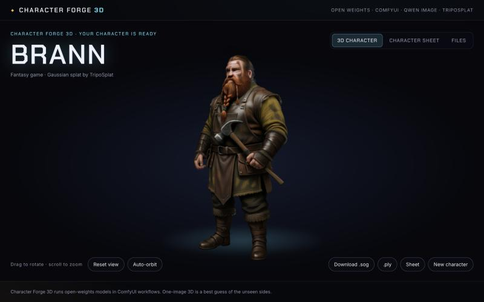
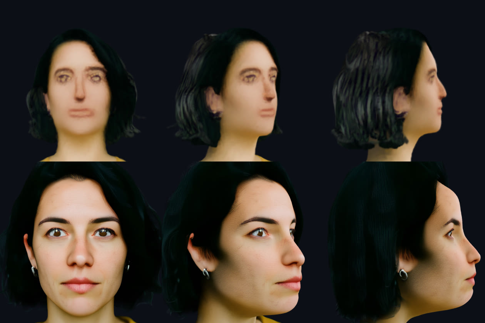
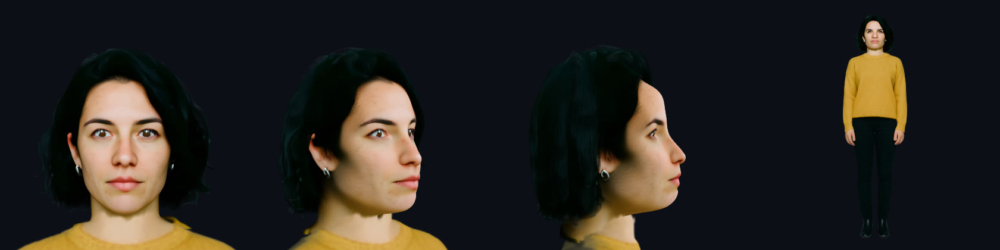

# Character Forge 3D

Upload a character portrait, or describe a character. Character Forge draws a full-body design for you to approve, a four-view character sheet, and a real 3D Gaussian splat that you rotate, zoom, inspect and download. The back of the splat comes from the sheet's back view. For photos, a second, face-only pass keeps the face sharp and true to the portrait.

Built for Comfy's [Open Source Higgsfield](https://comfy.org/open-source-higgsfield/) challenge, in the Open Weights Only category. Every generation step is an open-weights ComfyUI workflow. The app is not affiliated with Higgsfield.



## What you get

- **Two full-body designs** from Qwen Image Edit 2511. You approve one, or say what to change and draw two more.
- **A character sheet**: front, three-quarter, side and back, as one sheet and as separate images.
- **A Gaussian splat of the whole character** from TripoSplat, in a live viewer: drag to rotate, scroll to zoom, reset, auto-orbit. Its front comes from the approved design and its back from the sheet's back view.
- **A sharp face for photos.** A face pass rebuilds the head at full resolution and grafts it onto the body splat. The viewer also shows the head on its own as a close-up.
- **Files to keep**: the splat as `.sog`, `.spz` and `.ply`, a standalone `.html` viewer, the face splat, the sheet, orbit videos and the design.
- **No picture? Describe your character.** Qwen Image 2512 draws a portrait first.
- **Four styles**: 3D animated, anime, fantasy game art, or the look of your photo.
- **Optional textured mesh.** A TRELLIS.2 GLB with PBR materials, built from the approved front image on request.

## Why the back comes from the sheet

TripoSplat sees one image. From the front alone it guesses the back, and a cap or a hood can come out as a long flat wedge behind the head. So TripoSplat also rebuilds the sheet's back view, and `lib/two-sided.ts` joins the two splats. It turns the back splat 180 degrees, scales it to the front splat's height and cuts both through the middle of the body. The front splat keeps the shell that the front camera sees, so the front still looks like the approved design. The back splat fills in only behind that shell and inside the front outline.

We also tried Comfy's native multi-view model, Pixal3D, with the sheet's front, side and back views. On generated sheets it made flat slabs and lost the face, so the app does not use it.

## Why a face pass

In a full-body design, the face is only about 90 pixels tall. Every single-image 3D model sees only those pixels, so the face comes out soft, and a realistic face comes out wrong. The face pass starts again from the portrait. Qwen Image Edit draws a front-facing, chest-up image that takes the face from the portrait and the hair, collar and style from the approved design. TripoSplat then rebuilds that image, with the face filling the frame.

The face pass runs by itself only for the **As photographed** style. Its prompt describes a human face, and Qwen follows it even when both images show an animal or a cartoon creature. For the other styles, **Add face close-up** in the viewer adds it on request.

Top row: the face inside the full-body splat. Bottom row: the face pass. Mara is a generated, non-existent person.



The graft then joins the two splats. Both come from TripoSplat in the same frame, so no rotation is needed. `lib/graft.ts` finds the neck in each splat from its width profile. It scales the bust so its crown-to-neck height matches the body's, removes the body's own head and the body Gaussians inside the new head, and keeps a small overlap at the neck. When it cannot find a neck, or the two heads do not match in size, it skips the graft and the viewer shows the body and the face apart.



## How it works

```text
portrait (uploaded, or drawn from a description by Qwen Image 2512)      workflows/portrait.api.json
     │
     ▼
1. Canonical   Qwen Image Edit 2511 draws two full-body candidates.        workflows/canonical.api.json
               You approve one.
     │
     ├─────────────────────────┬───────────────────────────────┐   (all three at the same time)
     ▼                         ▼                               ▼
2. Sheet       Qwen Image   3. Body splat   BiRefNet cutout,   4. Face pass, photos only: Qwen      workflows/sheet.api.json
   Edit 2511 with the          TripoSplat, SPZ + PLY + orbit      Image Edit 2511 draws a chest-up   workflows/triposplat.api.json
   multiple-angles LoRA                                           image with the portrait's face,    workflows/headshot.api.json
     │                         │                                  then TripoSplat
     ▼                         │                               │
   Back splat: TripoSplat      │                               │
   on the sheet's back view    │                               │
     │                         │                               │
     └────────────┬────────────┘                               │
                  ▼                                            │
5. Join   the front and back splats (lib/two-sided.ts)         │
                  │                                            │
                  └─────────────────────┬──────────────────────┘
                                        ▼
6. Graft   the face-pass head onto the body (lib/graft.ts), then SplatTransform makes .sog and .html
                                               │
                                               ▼
7. Reveal      The flat sheet appears, then clears for the live splat. The camera eases from the
               front to a three-quarter view. The motion is a UI animation over the real 3D render.
```

Every model runs as a ComfyUI workflow on Comfy Cloud through `@comfyorg/sdk`. The graft, the format conversion and the sheet layout run locally in Node. You need no GPU.

| Step | ComfyUI nodes | Open-weights model |
| --- | --- | --- |
| Portrait | `UNETLoader`, `KSampler` | Qwen Image 2512 with the Lightning 4-step LoRA |
| Canonical body, face-pass image | `TextEncodeQwenImageEditPlus`, `FluxKontextMultiReferenceLatentMethod` | Qwen Image Edit 2511 with the Lightning 4-step LoRA |
| Character sheet | the same, with `LoraLoaderModelOnly` | Qwen Image Edit 2511 multiple-angles LoRA |
| Cutout | `LoadBackgroundRemovalModel`, `RemoveBackground` | BiRefNet |
| Body splat, face splat | `TripoSplatPreprocessImage`, `TripoSplatConditioning`, `VAEDecodeTripoSplat`, `SplatToFile3D`, `RenderSplat` | TripoSplat, with the DINOv3 encoder and the FLUX.2 VAE it ships with |
| Optional mesh | `Trellis2Conditioning` and the TRELLIS.2 stages | TRELLIS.2 |

No step uses a partner node or a closed API.

## Run it

You need [Node.js 22.6 or newer](https://nodejs.org/), a [Comfy API key](https://platform.comfy.org/profile/api-keys), and a [paid Comfy Cloud plan](https://www.comfy.org/cloud/pricing) on the workspace that owns the key. The Free tier has no API access.

```sh
git clone https://github.com/sshiao/character-forge.git
cd character-forge
cp .env.example .env.local
```

Put your key in `.env.local` as `COMFY_API_KEY`. Only the server reads it. Never commit `.env.local`. Then:

```sh
npm ci
npm run dev
```

Open <http://127.0.0.1:3000>. Add a portrait or describe a character, give it a name, pick a style and select **Forge character**.

To try the app with no key and no credits, set `FORGE_MOCK=1` in `.env.local`. Mock mode answers every Comfy step with the files of a real run in `examples/sky-pirate/`. The graft, the conversions, the sheet layout and the viewer still run for real.

Character Forge keeps each character in `.characters/<id>/`: its state in `character.json`, and every file next to it. It needs a long-running Node server, because the server makes the character in the background while the page polls. Resume picks up saved Comfy jobs after a network failure.

## Use the viewer

- **Full body | Face** switches between the grafted full body and the face splat on its own.
- **Compare front image only** shows the splat of the approved design alone, with no back from the sheet and no face pass, for a before-and-after.
- **Add back from sheet** adds the back to a character made before it existed.
- **Add face close-up** adds the face pass to a character that has none.
- **Build TRELLIS.2 mesh** makes an optional textured GLB from the approved front image. **Show TRELLIS.2 mesh** switches the viewer to it. See [the TRELLIS.2 notes](docs/trellis2.md).
- **Refine with ModelSheetTo3D** is experimental. It exports a bundle for a separate CUDA and Blender host and imports the result. It has not run on a GPU in this project. See [its guide](integrations/modelsheetto3d/README.md).

## Time and cost

On Comfy Cloud in November 2026, with a short queue:

| Step | Time |
| --- | --- |
| Portrait (only for a description) | about 30 s |
| Two canonical candidates | about 20–35 s |
| Sheet, body splat and face pass, at the same time | about 1.5 min |
| Back splat, after the sheet | about 40 s |
| Join, graft and conversion, locally | a few seconds |

Comfy Cloud bills GPU time on your plan. Our test runs used about two to three cents of credit for each image or splat workflow. A TRELLIS.2 mesh costs more. Check your Comfy account for the exact charges.

## Run one workflow on its own

`npm run forge` runs a single workflow from the command line and saves what it makes in `.test-output/`:

```sh
npm run forge -- portrait "a young sky pirate with brass goggles"
npm run forge -- canonical examples/sky-pirate/portrait.png
npm run forge -- sheet examples/sky-pirate/candidate-1.png
npm run forge -- splat examples/sky-pirate/candidate-1.png
npm run forge -- headshot .characters/<character-id>
npm run forge -- mesh examples/sky-pirate/candidate-1.png
```

`node scripts/graft.ts <body.ply> <head.ply> <out-dir>` grafts a face splat onto a body splat and renders a check sheet of the head with SplatTransform.

## The files

| File | What it is |
| --- | --- |
| `graft.sog`, `graft.ply`, `graft.html` | The full body with the face-pass head. The viewer and the main downloads use these. |
| `two-sided.sog`, `two-sided.ply`, `two-sided.html` | The front and back splats joined, before the face graft |
| `back.spz`, `back.ply` | TripoSplat of the sheet's back view |
| `head.sog`, `head.ply`, `head.png`, `head-orbit.mp4` | The face splat, the image it starts from, and its orbit video |
| `character.sog`, `.spz`, `.ply`, `.html`, `orbit.mp4` | The body splat before the graft |
| `sheet.png`, `view-*.png`, `canonical.png` | The character sheet and the approved design |
| `mesh-*.glb` | The optional TRELLIS.2 mesh, when you build one |

## Change it

- **Styles and prompts** are in `lib/forge.ts`. Add a style to `STYLES` and the page shows it.
- **The workflows** are in `workflows/`, in ComfyUI API format. `lib/workflows.ts` fills each one by node id.
- **The join** is `lib/two-sided.ts`, and **the graft** is `lib/graft.ts`. Their tests are in `test/two-sided.test.ts` and `test/graft.test.ts`.
- **The viewer** is `components/splat-viewer.tsx`, with [three.js](https://threejs.org/) and [Spark](https://sparkjs.dev/). The optional mesh viewer is `components/mesh-viewer.tsx`.
- **The page and the reveal** are `components/forge.tsx`, styled in `app/globals.css`.

| Path | What it holds |
| --- | --- |
| `app/api/characters` | Starts, lists, reads, approves and resumes characters, and serves their files |
| `lib/character.ts` | The producer that makes each character in the background |
| `lib/engine.ts`, `lib/comfy.ts` | The Comfy steps: upload, submit, wait, download |
| `lib/convert.ts` | SplatTransform and ffmpeg |
| `lib/mock.ts` | Mock mode |
| `lib/modelsheet.ts`, `integrations/modelsheetto3d/` | The experimental ModelSheetTo3D bundle and adapter |
| `examples/sky-pirate/` | The inputs and outputs of a real run, for mock mode |
| `test/` | Unit tests for the workflows, the join, the graft, TRELLIS.2 and ModelSheetTo3D bundles |

Run the tests and the type check with `npm test`.

## Limits

- The multiple-angles LoRA invents the views it cannot see, and the back splat rebuilds what the LoRA drew. The front and back splats guess depth on their own, so the join can leave a seam at the sides, a fin at the top of a cap, or a logo showing faintly through the back.
- A body drawn from a headshot invents the costume below the frame. That is why you approve a design first.
- The face pass draws a new image of the head, so it can still drift from the portrait. Check it against the source.
- The graft can leave a visible edge at the neck from some angles, mostly on a bare neck. A scarf, a collar or long hair hides it. When the neck finder fails, there is no graft.
- Stylized characters with a clear silhouette rebuild best. Thin, loose parts such as capes, hair strands and held props can come out soft.
- Pictures up to 20 MB, PNG, JPEG or WebP. The page scales them to 1600 px before upload.
- Use pictures you have the right to use. Do not upload a real person's photo without their consent.

## License

MIT. See [`LICENSE`](LICENSE). The API routes adapt code from Comfy Org's MIT-licensed [comfy-openjutsu](https://github.com/Comfy-Org/comfy-openjutsu) template. See [`THIRD_PARTY_NOTICES`](THIRD_PARTY_NOTICES).

The models have their own licenses. Read each model card before you use the outputs commercially: [Qwen Image and Qwen Image Edit](https://huggingface.co/Qwen), the [Lightning LoRAs](https://huggingface.co/lightx2v), the [multiple-angles LoRA](https://huggingface.co/fal/Qwen-Image-Edit-2511-Multiple-Angles-LoRA), [TripoSplat](https://huggingface.co/VAST-AI/TripoSplat), [TRELLIS.2](https://github.com/microsoft/TRELLIS.2) and [BiRefNet](https://huggingface.co/Comfy-Org/BiRefNet).

The app uses [SplatTransform](https://github.com/playcanvas/splat-transform) and the SuperSplat viewer by PlayCanvas (MIT), [Spark](https://github.com/sparkjsdev/spark) by World Labs (MIT), [three.js](https://github.com/mrdoob/three.js) (MIT) and [ffmpeg-static](https://github.com/eugeneware/ffmpeg-static) (GPL-3.0-or-later, a separate binary).
