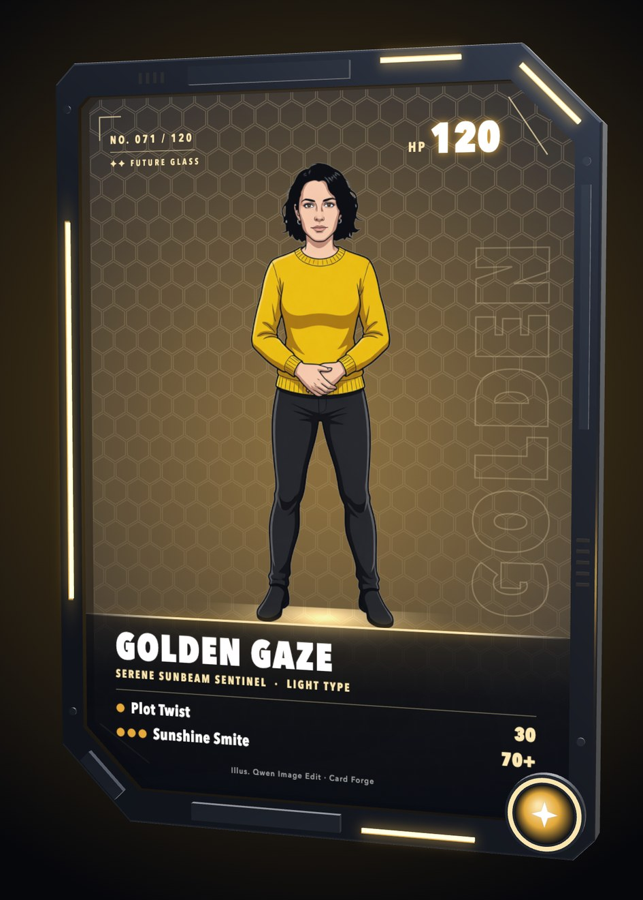

# Card Forge

Turn a photo into a holo trading card. Qwen3-VL looks at the photo and writes the card: a name, an element, HP, an ability, two moves and flavor text that fit the person. Qwen Image Edit paints the person as the hero. Pick one of nine frames, from vintage holo to a 3D glass card, tilt the card in the light, edit any line, and download it as a PNG or a turntable video.

Built for Comfy's [Open Source Higgsfield](https://comfy.org/open-source-higgsfield/) challenge, in the Open Weights Only category. Every generation step is an open-weights ComfyUI workflow. The app is not affiliated with Higgsfield. The card designs are original: the frames take their looks from familiar eras of trading cards and ball cards, but are not tied to any game, brand or league.

<p>
  
  
</p>

Mara is a generated person who does not exist. Her card comes from the demo run.

**Demo video (1:40):** [watch on X](https://x.com/sshiao/status/2117509428878717417) or [download the MP4](https://github.com/sshiao/card-forge/releases/download/v1.0.0/card-forge-demo.mp4). The voiceover is Qwen3-TTS, also run on Comfy Cloud.

## What you get

- **Card text from your photo.** Qwen3-VL-8B reads your clothes, colors, setting and expression and writes a name, a title, an element, HP, an ability, two moves, a weakness, a resistance, a retreat cost and flavor text. It picks the element from your strongest colors, unless you choose one.
- **You as the hero.** Qwen Image Edit 2511 paints you in a heroic pose, in a scene that fits the card, with your face kept. It paints two versions, and you pick one. If neither is right, write what to change and draw two more.
- **Your clothes, or a hero outfit.** By default the art keeps the clothes you wear in the photo. Choose **Hero outfit** to wear a new outfit that Qwen3-VL designs for the card. You can switch before each new pair of art.
- **Nine frames.** Six battle-card frames: vintage holo, modern, full art, gold rare, illustration rare and rainbow rare. Two sports-card frames, chrome refractor and retro cardboard, show the name, the title and the element on the front, with no moves, like a ball card. Switch frames at any time. Each frame has its own foil that follows your pointer.
- **A 3D glass card.** The **Future glass** frame is a see-through sci-fi card in 3D: a metal frame with neon edges, two panes of glass with a hex grid, and you, cut out of the art by BiRefNet, standing on a lit nameplate. Drag it to turn it all the way round. Only the card is futuristic: the art keeps your art style and your clothes.
- **Your card, your words.** Edit the name, HP, moves and every other line after the card is made.
- **Files to keep:** the card as a 1260 × 1760 PNG, and the art on its own. The glass card also records a 6-second turntable video at 1080 × 1920, ready for a story or a reel.
- **Four art styles:** anime, painted, 3D animated and photo-real.

## How it works

```text
photo
  │
  ▼
1. Card text   Qwen3-VL-8B Instruct reads the photo and answers with JSON:          workflows/card-text.api.json
               name, element, HP, ability, moves, stats, flavor, pose, scene and a hero outfit
  │
  ▼
2. Art         Qwen Image Edit 2511 with the Lightning 4-step LoRA paints the       workflows/card-art.api.json
               person in that pose and scene, in their own clothes or the hero      workflows/card-cutout.api.json
               outfit. Wide art for framed cards, tall art for full-art cards.
               For the glass card, it paints them on a plain background, and
               BiRefNet cuts them out. Two candidates; you pick one.
  │
  ▼
3. Card        The browser draws the frame, the text and the element badges as      components/card.tsx
               one SVG, adds the foil, and exports the PNG. Three.js draws the      components/glass.tsx
               glass card in 3D and records its turntable video.
```

| Step | ComfyUI nodes | Open-weights model |
| --- | --- | --- |
| Card text | `AILab_QwenVL_Advanced` (ComfyUI-QwenVL), `SaveText` | Qwen3-VL-8B-Instruct |
| Art | `TextEncodeQwenImageEditPlus`, `FluxKontextMultiReferenceLatentMethod`, `KSampler` | Qwen Image Edit 2511 with the Lightning 4-step LoRA |
| Cutout, for the glass card | `LoadBackgroundRemovalModel`, `RemoveBackground`, `InvertMask`, `JoinImageWithAlpha` (all core nodes) | BiRefNet |

No step uses a partner node or a closed API. `lib/forge.ts` checks every field of the model's answer and replaces anything out of range, so a bad answer cannot break a card.

## Run it

You need [Node.js 22.6 or newer](https://nodejs.org/), a [Comfy API key](https://platform.comfy.org/profile/api-keys), and a [paid Comfy Cloud plan](https://www.comfy.org/cloud/pricing) on the workspace that owns the key. The Free tier has no API access.

```sh
git clone https://github.com/sshiao/card-forge.git
cd card-forge
cp .env.example .env.local
```

Put your key in `.env.local` as `COMFY_API_KEY`. Only the server reads it. Never commit `.env.local`. Then:

```sh
npm ci
npm run dev
```

Open <http://127.0.0.1:3000>. Add a photo, choose a frame, and select **Forge my card**.

To try the app with no key and no credits, set `FORGE_MOCK=1` in `.env.local`. Mock mode answers both Comfy steps with the files of real runs in `examples/card/`, including the cutouts for the glass card. Mara, in those files, is a generated person who does not exist.

Card Forge keeps each card in `.cards/<id>/`: its state in `card.json`, and the photo and the art next to it. It needs a long-running Node server, because the server makes the card in the background while the page polls. A resume picks up saved Comfy jobs after a network failure.

## Time and cost

On Comfy Cloud in November 2026:

| Step | Time |
| --- | --- |
| Card text | about 50–80 s, most of it loading Qwen3-VL |
| Two art candidates | about 20–40 s with a short queue. The cutouts for the glass card took 39 s in our test. |
| Frame, edits and PNG, in the browser | instant |

Comfy Cloud bills GPU time on your plan. In our tests a card cost about 10 cents of credit: about 7 for the text, mostly loading Qwen3-VL, and about 3 for each pair of art candidates. Check your Comfy account for the exact charges.

## Run one step on its own

`npm run forge` runs a single step from the command line and saves what it makes in `.test-output/`:

```sh
npm run forge -- text examples/card/photo.png
npm run forge -- art examples/card/photo.png examples/card/text.json gold painted hero
```

## Change it

- **Prompts, elements, frames, art styles and outfits** are in `lib/forge.ts`. The parser for the model's answer, `parseCardText`, is there too.
- **The card frames** are in `components/card.tsx`, drawn as SVG on a 630 × 880 grid. `SportsFace` draws the two sports frames, and `GlassFace` the flat glass card for the lists.
- **The 3D glass card** is in `components/glass.tsx`: the frame, the glass, the text canvases, the drag to turn, and the PNG and video exports.
- **The foil and the tilt** are in `app/globals.css`, under "The card screen".
- **The workflows** are in `workflows/`, in ComfyUI API format. `lib/workflows.ts` fills each one by node id.

| Path | What it holds |
| --- | --- |
| `app/api/cards` | Starts, lists, reads, picks, redraws and edits cards, and serves their files |
| `lib/card.ts` | The producer that makes each card in the background |
| `lib/engine.ts`, `lib/comfy.ts` | The Comfy steps: upload, submit, wait, download |
| `lib/mock.ts` | Mock mode |
| `components/forge.tsx` | The upload form, the progress screen, the review and the card screen |
| `examples/card/` | The inputs and outputs of a real run, for mock mode and the tests |
| `test/` | Unit tests for the workflows, the prompts and the parser |

Run the tests and the type check with `npm test`.

## Limits

- Qwen Image Edit draws a new picture, so a face can drift from the photo. Pick the closer candidate, or say what to fix and draw two more.
- Qwen3-VL can repeat itself across cards, for example in names or moves. Edit any line on the card screen.
- A frame with another shape crops the art. **Paint art for this frame** paints new art in the right shape.
- The PNG uses your system's fonts, because a browser cannot load web fonts into an exported SVG.
- The glass card needs WebGL. Without it, the card shows flat. The browser encodes the turntable video as an MP4 with WebCodecs in a few seconds. A browser with no H.264 encoder records it in real time instead, as MP4 or WebM, so keep the tab in front while it records.
- Use photos you have the right to use. Ask before you make a card of someone else. The prompt tells Qwen3-VL to joke about the hero's style and habits, never about their looks, body, age or background.

## History

Card Forge started as Character Forge, a photo-to-3D character app with Gaussian splats and meshes. That version is in the git history at the tag `3d-snapshot`.

## License

MIT. See [`LICENSE`](LICENSE). The API routes adapt code from Comfy Org's MIT-licensed [comfy-openjutsu](https://github.com/Comfy-Org/comfy-openjutsu) template. See [`THIRD_PARTY_NOTICES`](THIRD_PARTY_NOTICES).

The models and the custom node have their own licenses. Read each one before you use the outputs commercially: [Qwen3-VL](https://huggingface.co/Qwen/Qwen3-VL-8B-Instruct), [Qwen Image Edit](https://huggingface.co/Qwen), the [Lightning LoRAs](https://huggingface.co/lightx2v), [BiRefNet](https://github.com/ZhengPeng7/BiRefNet) and [ComfyUI-QwenVL](https://github.com/1038lab/ComfyUI-QwenVL). [Three.js](https://threejs.org/) is MIT-licensed. [Mediabunny](https://mediabunny.dev/), which writes the MP4, is MPL-2.0.
