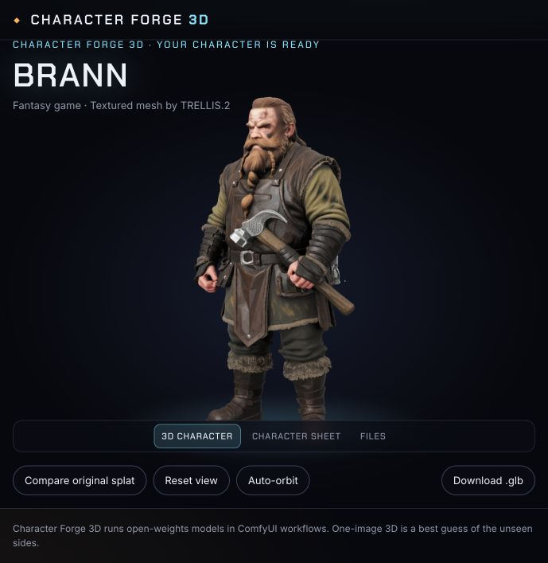

# TRELLIS.2 reconstruction

The 3D step runs native TRELLIS.2 on **Comfy Cloud**, using the same `COMFY_API_KEY` as the Qwen steps. No local GPU, custom node, separate worker, or new hosting account is needed. A paid Comfy Cloud workspace with API access and credits is required.

New characters now use **experimental multiview conditioning**. The approved full-body image and the generated three-quarter, side and back views each get their own background removal, crop and DINO encoding. The sheet must finish before 3D generation starts.

The Comfy sampler combines separate denoising predictions on the same latent with weights: front 70%, three-quarter 15%, side 10%, back 5%. Each condition retains its own low- and high-resolution image tokens through all generation stages. This is weighted multidiffusion, not concatenating a collage, averaging just the token embeddings, or using a multiview-trained model with calibrated cameras. No new custom nodes or hosting service is needed. ModelSheetTo3D is not included.

Original single-image generation remains available through `npm run forge -- mesh`. Existing characters retain their recorded input mode on Resume. **Rebuild from sheet** switches an existing character to multiview and keeps its previous GLB for comparison. New output filenames are versioned to avoid stale browser caches.

## Run an existing approved character

Start the app with `npm run dev`, open a finished character from the roster, and select **Rebuild from sheet**. This keeps its approved image, sheet, and legacy splat; it does not spend credits on generating new Qwen images. Once the mesh is ready, **Compare previous mesh** switches between the saved meshes; legacy splats can also be compared. **Face close-up** frames the head for inspection, and **Wireframe** shows topology.

For a standalone test:

```sh
npm run forge -- multiview .characters/mvypotqo-9678af .test-output/multiview-test
# Original single-image baseline:
npm run forge -- mesh .characters/mvylitst-e12605/canonical.png .test-output/trellis2-brann
```

The CLI writes `mesh-1.glb` in the chosen output directory. New characters in the app use TRELLIS.2 by default. Mock mode retains the existing sky-pirate splat fixtures; it does not simulate a successful TRELLIS.2 generation.

## Workflow and quality settings

`workflows/trellis2.api.json` follows Comfy's native TRELLIS.2 pipeline with the Pixal3D branch and frontend preview nodes removed. It uses:

- BiRefNet background removal and centered 1024 px input, with `pad_factor=1.0` for TRELLIS.2.
- Comfy's `trellis_2_int8_convrot.safetensors` checkpoint, DINOv3-L conditioning, and BF16 shape/texture VAEs.
- Structure sampling, 512 shape sampling, upsampling to a target of 1536, then texture sampling.
- 1024-resolution narrow-band remeshing, no vertex smoothing, and no dropping of small components. These choices aim to preserve accessories and small details, but must be judged on the output.
- A one-million-face decimation target, 4K UV atlas and base-color/metallic/roughness textures, 4K normal map, and 1K ambient occlusion.
- `MeshToFile3D` and `SaveGLB` to preserve embedded PBR maps.

These are quality-oriented starting settings, not a claim of optimal fidelity. The export face target is a ceiling, not a guarantee. Remeshing and decimation can change fine geometry. The quantized checkpoint is the native Comfy template's checkpoint; the official Microsoft reference implementation is a separate runtime and may produce different results.

All four diffusion stages use the character's saved seed. The app persists the Comfy job id before waiting. Network retries and Resume reconnect to that job instead of submitting a second one. A failed Comfy job can be resubmitted; successful sheet outputs are kept.

The GLB is displayed with three.js `GLTFLoader`, environment lighting, orbit controls, automatic framing, and embedded textures. Existing SOG/SPZ characters continue to use Spark. The viewer is for static asset inspection; this step does not produce a rig or animation-ready topology.

## First real run: Brann

On November 1, 2026, the native workflow ran successfully on Comfy Cloud using the project's existing API key. The standalone CLI completed in approximately 76 seconds, including waiting and downloading. The exported GLB is 89,362,492 bytes (85.2 MiB), with 997,615 triangles and three embedded 4096×4096 PNG images: base color, packed material/occlusion, and normal. Seed: `1410644842`.

The output is attached to Brann's existing local character (`mvylitst-e12605`) as `character.glb`. His canonical image, sheet and original splat remain intact. The browser viewer, auto-orbit, reset, legacy comparison, range download and saved-job reconnection were checked. This is one successful baseline, not a quality benchmark.



## Evaluate the result

Use the same approved design and inspect the exported GLB, rather than only a preview render. Compare front, three-quarter, side and back against the sheet. Check facial proportions, beard/hair volume, hands, held props, limb separation, silhouette, costume and back details. Inspect with textures and in a plain material in Blender to distinguish geometry from painted detail.

## Facial likeness findings

The photographic full-body test (`mvypotqo-9678af`) was rerun with the same seed and all four views. The native multiview job succeeded on Comfy Cloud in about 110 seconds, but inspection showed that facial likeness and dark eye artifacts remained poor. Removing normal maps, ambient occlusion and lighting in a temporary diagnostic GLB did not remove the eye artifacts; that diagnostic is not retained as the final result. The previous and multiview GLBs are both preserved.

More polygons or larger baked textures do not restore identity lost during generation. A head-specific reconstruction from the original high-resolution portrait, with its own detail and texture budget, is a possible next step. Joining it to a separately generated body requires alignment, neck seam handling and texture matching. This head/body assembly has not been implemented.

The generated sheet views can disagree in proportions or clothing, and experimental denoising averaging can worsen details. Inspect the actual result; multiview is not a likeness guarantee. A separate Pixal3D native camera-aware multiview trial also succeeded on Cloud (about 70 seconds), but its face and hair were visibly distorted on this example. It was not selected as the final result or made the default. Its diagnostic output is retained locally as `mesh-pixal-study.glb`; it is a different model from TRELLIS.2.

## Sources

- [Comfy TRELLIS.2 tutorial](https://docs.comfy.org/tutorials/3d/trellis2)
- [Native integration announcement](https://blog.comfy.org/p/trellis2-and-pixal3d-are-now-native)
- [Comfy workflow template](https://github.com/Comfy-Org/workflow_templates/blob/main/templates/3d_pixal3d_trellis2_image_to_model.json)
- [Comfy checkpoint files](https://huggingface.co/Comfy-Org/TRELLIS.2)
- [Microsoft reference implementation](https://github.com/microsoft/TRELLIS.2)

## Head-only experiment

A 640×800 crop of the original uploaded portrait was reconstructed separately with the same native single-image TRELLIS.2 workflow, instead of using the generated full-body image. This run completed on Cloud in about 131 seconds, exporting a head/bust with 999,606 triangles and embedded textures. The local character is `headstudy-0b01bf`. It has its own GLB and source image; it is not joined to the body.

The head study shows more eye and facial detail than the full-body reconstruction, but the likeness and surface quality still need evaluation. This supports testing separate head/body budgets, not claiming that polygon density alone solves identity.

## Optional ModelSheetTo3D refinement

The finished-character viewer now provides **Refine with ModelSheetTo3D**. It prepares the existing base mesh, four views, explicit camera yaws and a user-drawn face-detail polygon for the released ModelSheetTo3D pipeline. An included Python adapter runs segmentation, learned line extraction and upstream refinement on an external CUDA host; its result ZIP can be imported with matching-job and unchanged-base checks. The original mesh is retained for comparison. Preparing a bundle does not submit any GPU work.

The GLB contains flat-colored geometry and a separate face decal POINTS layer. Upstream stylized rendering is a separate preview, not a claim of the same appearance in every GLB viewer. This method targets hand-drawn flat-color sheets and may degrade shaded/PBR images. GPU execution remains unverified pending an available host. See [the runner guide](../integrations/modelsheetto3d/README.md) for requirements and exact commands.
